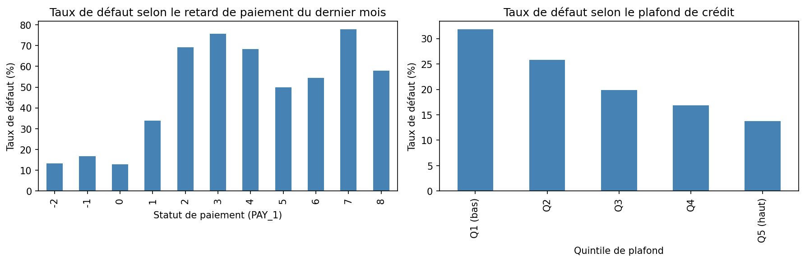
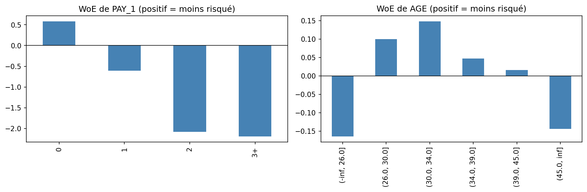
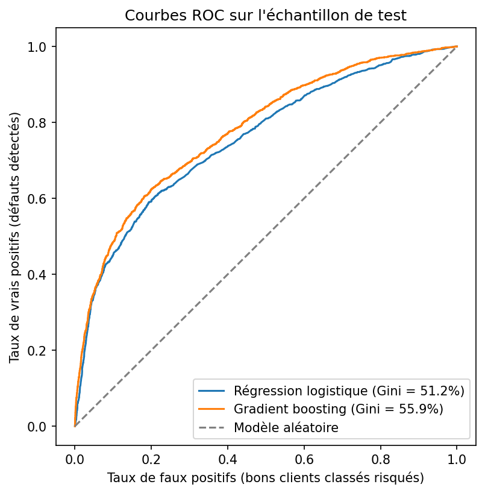
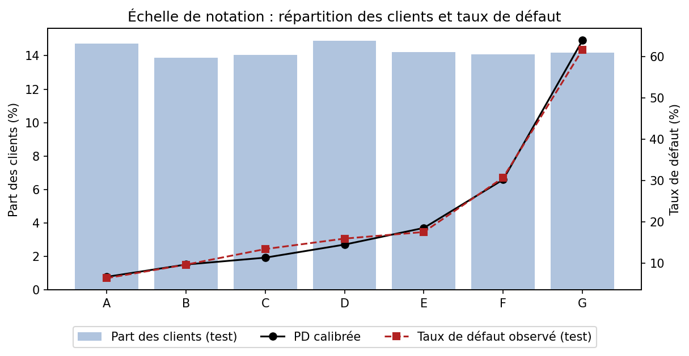
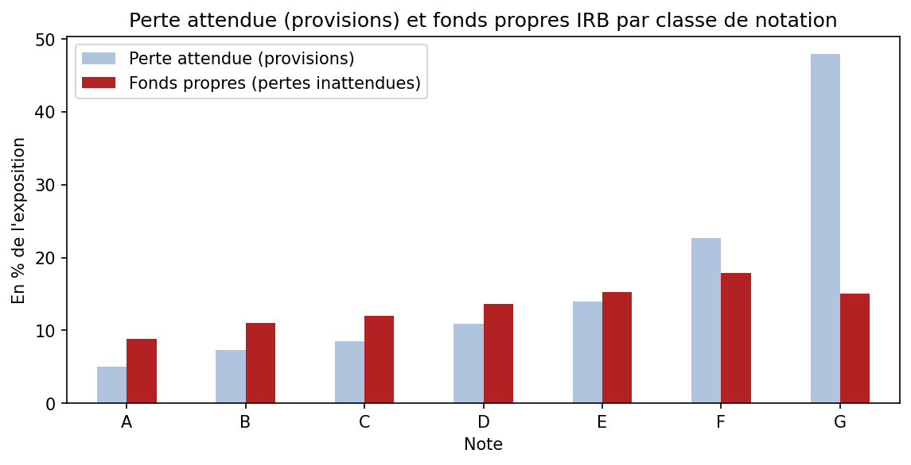
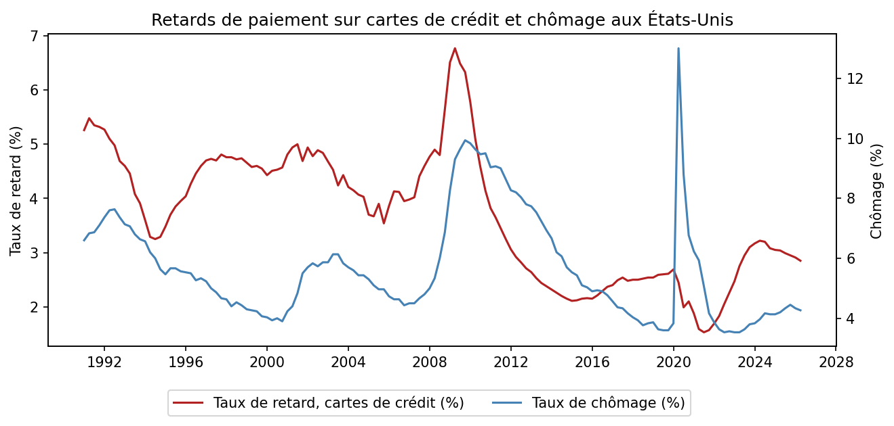

# Modèle de risque de crédit : probabilité de défaut, notation et stress test

Construction d'un modèle de **probabilité de défaut (PD)** sur 30 000 clients de cartes de crédit, transformé en
**échelle de notation**, puis utilisé pour calculer la **perte attendue**, les **fonds propres réglementaires (IRB)**
et l'impact d'un **stress test macroéconomique**.

**En bref :**
- Régression logistique sur WoE : **Gini de 51,2 %** sur l'échantillon de test, 6 variables explicables.
- Échelle de **7 classes de notation** calibrées (PD de 6,7 % à 63,9 %), validées par tests binomiaux et PSI.
- Scénario sévère (+5 points de chômage) : **perte attendue +30 %**, fonds propres +13 %.

## Données

- **30 000 titulaires de cartes de crédit à Taïwan** (2005) : plafond, profil, historique de paiement sur 6 mois,
  montants facturés et remboursés. Source : [UCI Machine Learning Repository](https://archive.ics.uci.edu/dataset/350/default+of+credit+card+clients) (licence CC BY 4.0).
- **Taux de défaut : 22,1 %**, élevé en raison de la crise du crédit à la consommation à Taïwan en 2005.
- **Données macroéconomiques** : taux de retard sur cartes de crédit et taux de chômage aux États-Unis (1991-2026),
  base [FRED](https://fred.stlouisfed.org/) de la Réserve fédérale de Saint-Louis.
- Échantillons : 70 % apprentissage (21 000 clients), 30 % test (9 000 clients), stratifiés sur le défaut.
- Le sexe est exclu du modèle : son usage est interdit dans l'octroi de crédit en Europe.

<p align="center">
  <br>
  <em>Le taux de défaut explose avec le retard de paiement et diminue avec le plafond de crédit</em>
</p>

## 1. Préparation des variables : WoE et Information Value

Les variables sont découpées en classes, puis remplacées par leur *Weight of Evidence* (WoE), comme dans les modèles
de scoring bancaires. Leur pouvoir prédictif est mesuré par l'*Information Value* (IV).

| Variable | IV | Pouvoir prédictif |
|---|---:|---|
| Retard de paiement du dernier mois | 0,879 | Très fort |
| Nombre de mois en retard (6 mois) | 0,869 | Très fort |
| Retard maximal (6 mois) | 0,807 | Très fort |
| Plafond de crédit | 0,167 | Moyen |
| Montant remboursé | 0,156 | Moyen |
| Taux d'utilisation du plafond | 0,066 | Faible |
| Âge | 0,014 | Inutile |

<p align="center">
  <br>
  <em>WoE du retard de paiement (parfaitement monotone) et de l'âge (effet en U, mais trop faible pour être utile)</em>
</p>

## 2. Modèle de scoring

Sélection des variables : IV ≥ 0,02, corrélation < 0,7 entre variables, coefficients significatifs et de signe cohérent.
Le modèle final retient **6 variables** : retard du dernier mois, retard maximal sur 6 mois, plafond, montant remboursé,
taux d'utilisation et niveau d'éducation.

| Modèle | Gini apprentissage | Gini test | AUC test | KS test |
|---|---:|---:|---:|---:|
| **Régression logistique (retenue)** | 53,2 % | **51,2 %** | 75,6 % | 39,6 % |
| Gradient boosting (challenger) | 61,9 % | 55,9 % | 78,0 % | 42,4 % |

<p align="center">
  <br>
  <em>Courbes ROC sur l'échantillon de test</em>
</p>

La régression logistique est retenue pour son **explicabilité** et sa **stabilité** (2 points d'écart entre apprentissage
et test, contre 6 pour le gradient boosting). Le challenger, plus performant de 4,7 points, signale des interactions
non captées par le modèle linéaire.

## 3. Échelle de notation

| Classe | A | B | C | D | E | F | G |
|---|---:|---:|---:|---:|---:|---:|---:|
| PD calibrée | 6,7 % | 9,7 % | 11,4 % | 14,5 % | 18,6 % | 30,2 % | 63,9 % |
| Taux observé (test) | 6,4 % | 9,7 % | 13,4 % | 16,0 % | 17,6 % | 30,7 % | 61,7 % |

- **7 classes d'effectifs équilibrés** (14 à 15 % des clients chacune), définies sur les quantiles de PD.
- PD calibrées et taux observés **strictement croissants** ; **6 classes sur 7** passent le test binomial.
- **PSI de 0,0003** : population parfaitement stable entre apprentissage et test.

<p align="center">
  <br>
  <em>Répartition des clients et taux de défaut par classe de notation</em>
</p>

## 4. Perte attendue et fonds propres réglementaires

Hypothèses : **LGD de 75 %** (crédit revolving non garanti), **EAD** = montant utilisé + 50 % du montant non utilisé.
Fonds propres calculés avec la **formule IRB de Bâle** pour les crédits revolving aux particuliers (corrélation de 4 %).

| Indicateur | Montant | En % de l'exposition |
|---|---:|---:|
| Exposition (EAD) | 989 M NT$ | – |
| Perte attendue (provisions) | 132 M NT$ | 13,3 % |
| Fonds propres IRB | 121 M NT$ | 12,2 % |
| Actifs pondérés (RWA) | 1 514 M NT$ | 153 % |

<p align="center">
  <br>
  <em>Perte attendue et fonds propres par classe de notation</em>
</p>

Les fonds propres culminent pour la classe F puis **baissent pour la classe G** : pour les clients les plus risqués,
la perte est majoritairement attendue, donc couverte par les provisions plutôt que par les fonds propres.
La classe G concentre **35 % de la perte attendue** pour 10 % de l'exposition.

## 5. Stress test macroéconomique

Un **modèle satellite** relie le taux de retard sur cartes de crédit au chômage (données américaines, 1991-2026).

| Spécification du modèle satellite | β (sensibilité au chômage) | R² |
|---|---:|---:|
| Niveaux, toute la période | 0,051 | 0,06 |
| Niveaux, hors Covid | 0,072 | 0,13 |
| **Variations sur un an, hors Covid (retenue)** | **0,082** | **0,20** |

<p align="center">
  <br>
  <em>Retards de paiement et chômage aux États-Unis : la relation est rompue pendant le Covid (aides publiques)</em>
</p>

| Scénario | PD moyenne | Perte attendue | Fonds propres | Hausse du total |
|---|---:|---:|---:|---:|
| Central (chômage stable) | 17,7 % | 131,6 M NT$ | 121,1 M NT$ | – |
| Adverse (+3 points de chômage) | 20,8 % | 154,5 M NT$ | 130,7 M NT$ | +13 % |
| **Sévère (+5 points, type 2008-2009)** | **23,1 %** | **171,3 M NT$** | **136,9 M NT$** | **+22 %** |

- **Les provisions sont plus touchées que les fonds propres** (+30 % contre +13 % en scénario sévère).
- **En proportion, les meilleurs clients se dégradent le plus** : +46 % de PD pour la classe A, contre +14 % pour la classe G.
- **Le modèle satellite initial sous-estimait presque de moitié l'impact d'une crise**.

## Limites et pistes d'amélioration

- **Horizon du défaut d'un mois**, contre un an exigé par la réglementation.
- **LGD et EAD fixées par hypothèse**, faute de données de recouvrement.
- **Pas de validation hors période** (*out-of-time*), faute de dimension temporelle dans les données.
- **Stress test simplifié** : une seule variable macroéconomique, données américaines, pas de migrations de notes.
- **Pistes** : enrichir le modèle logistique, modéliser la LGD et l'EAD, modèle satellite multivarié avec décalages.

## Structure du dépôt

```
modele-risque-credit/
├── modele_risque_credit.ipynb   Notebook complet (code, résultats et commentaires)
├── data/                        Données (UCI et FRED), sauvegardées au premier lancement
├── figures/                     Graphiques
├── requirements.txt             Bibliothèques Python nécessaires
└── README.md
```

## Installation

```bash
git clone https://github.com/LeoFARINA23/modele-risque-credit.git
cd modele-risque-credit
python -m venv .venv
.venv\Scripts\activate          # Windows (sur Mac/Linux : source .venv/bin/activate)
pip install -r requirements.txt
```

Ouvrir ensuite `modele_risque_credit.ipynb` dans Jupyter ou VS Code et exécuter toutes les cellules.

## Outils

Python 3.9 · pandas · NumPy · SciPy · statsmodels · scikit-learn · matplotlib

## Projet associé

[Mesure du risque de marché d'un portefeuille d'actions du CAC 40](https://github.com/LeoFARINA23/var-portefeuille-cac40) :
VaR, Expected Shortfall, backtesting et stress tests.

## Auteur

**Léo Farina**, élève ingénieur en Finance & Ingénierie Quantitative à l'ECE Paris.
[LinkedIn](https://www.linkedin.com/in/leo-farina) · leo.farina@edu.ece.fr